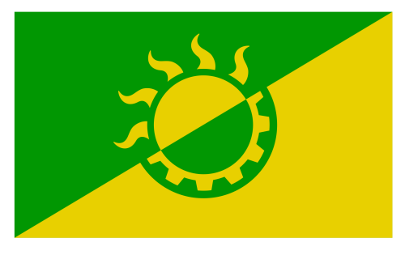

# Awesome Sustainable Finance

A curated list of **Sustainable Finance** resources. The term sustainable finance is here understood _broadly_, addressing both environmental and social issues.

# Description

The focus of the awesome sustainable finance list is:

- **open source code** (software), whether this concerns _tools_, _libraries_, _frameworks_ etc. that support any type of sustainable finance effort, and 
- **open data** that are useful in a sustainable finance context, e.g., as inputs, reference data or other related role

Are you interested to contribute to this collection of sustainable finance resources? [Here is how](CONTRIBUTING.md). 

Image Credit: StarwallOfRadical.town, [CC BY-SA 4.0](https://creativecommons.org/licenses/by-sa/4.0), via Wikimedia Commons

# Classification

The following list shows the current classification scheme. As the list grows we may introduce more / different sub-categories. 

- [Open Source Frameworks](#open-source-frameworks)
  - [Climate Finance](#climate-finance)
  - [EEIO](#environmentally-extended-input-output-models)
  - [LCA](#life-cycle-assessment)
  - [Carbon Footprint](#other-carbon-footprint)
  - [Integrated Assessment Models](#integrated-assessment-models)
  - [Biodiversity Finance](#biodiversity-finance)
  - [Circular Economy](#circular-economy)
  - [Economic Networks](#economic-networks)
  - [Social Finance](#social-finance)
    - [Financial Inclusion](#financial-inclusion)
    - [Financial Literacy](#financial-literacy)
- [Open Data](#open-data)
  - [EEIO Databases](#eeio-databases)
  - [LCA Databases](#lca-databases)
  - [GHG Emissions](#ghg-emissions)
  - [Energy System](#energy-system)
  - [Other Sustainability Data](#other-sustainability-data)
- [Related Domains](#related-domains)

# Open Source Frameworks

This section focuses on software projects (_Models and Tools_) that are primarily code oriented. Projects are grouped by domain. The split is for practical reasons, there are various conceptual overlaps between domains. The progression is from the more directly relevant in financial context, to the more indirectly and supportive. The section of _related domains_ links to other such broad catalogs of indirectly relevant tools.

## Climate Finance

Frameworks and tools that are *directly* assisting the analysis and management of financial operations (e.g., transactions, securities, portfolios of contracts etc.) from a _climate finance_ perspective

- [PACTA](https://github.com/2DegreesInvesting/PACTA_analysis) - Run the PACTA analysis on EQ & CB portfolios.
- [r2dii.analysis](https://github.com/2DegreesInvesting/r2dii.analysis) - Tools to Calculate Climate Targets for Financial Portfolios. 
- [SBTi Temperature Alignment tool](https://github.com/ScienceBasedTargets/SBTi-finance-tool) - This toolkit helps companies and financial institutions to assess the temperature alignment of current targets, commitments, and investment and lending portfolios, and to use this information to develop targets for official validation by the SBTi.
- [Equinox](https://github.com/open-risk/equinox) - Equinox is an open source platform that supports the holistic risk management of sustainable finance projects.
- [OS-Climate](https://github.com/os-climate) - Open Source Solutions to Enable Climate-Smart Investing.
- [blockchain-carbon-accounting](https://github.com/hyperledger-labs/blockchain-carbon-accounting) - This project implements blockchain applications for climate action and accounting, including emissions calculations, carbon trading, and validation of climate claims. It is part of the Linux Foundation's Hyperledger Climate Action and Accounting SIG.
- [ESG Reg Reporting](https://gitlab.com/finosfoundation/legend/reg-innovation/esg-reg-reporting) - A FINOS project to enable banks to consume 3rd party ESG data for the purposes of EU regulatory reporting.
- [open-climate-investing](https://github.com/opentaps/open-climate-investing) - Application and data for analyzing and structuring portfolios for climate investing.
- [climate-finance](https://github.com/ONEcampaign/climate-finance-package) - climate-finance is the python package to get, clean, and work with international public climate finance.

## Biodiversity Finance

- [riskmapjnr](https://github.com/ghislainv/riskmapjnr) - The riskmapjnr Python package can be used to obtain maps of the spatial risk of deforestation and forest degradation

## Economic Networks

Models of economic networks and platforms supporting economic networks and payment systems

- [Valueflows](https://codeberg.org/valueflows/valueflows) - Valueflows (VF) is a vocabulary for the distributed economic networks of the next economy, to coordinate the creation, distribution, and exchange of economic resources.
- [GNU Taler](https://www.taler.net/en/development.html) - Privacy-preserving electronic payment system
- [Bonfire Networks](https://github.com/bonfire-networks) - federated network for individuals and communities to design, operate and control their own digital lives

### Interledger

- [rafiki](https://github.com/interledger/rafiki) - An open-source, comprehensive Interledger service for wallet providers, enabling them to provide Interledger functionality to their users.
- [web-monetization](https://github.com/interledger/web-monetization-extension) - An open-source browser extension that enables Web Monetization.
- [interledger-rs](https://github.com/interledger/interledger-rs) - An easy-to-use, high-performance Interledger implementation written in Rust

## Integrated Assessment Models

Integrated economic models (for macroeconomic scenarios) that integrate aspects of sustainability.

- [mimi](https://github.com/mimiframework/Mimi.jl) - Mimi is a Julia package that provides a component model for integrated assessment models.
- [MessageIX](https://github.com/iiasa/message_ix) - MESSAGEix is a versatile, dynamic, model framework for energy-engineering-economy-environment (E4) systems research.
- [aneris](https://github.com/iiasa/aneris) - Harmonization of Emissions Trajectories for Integrated Assessment Models.
- [premise](https://github.com/polca/premise) - PRospective EnvironMental Impact AsSEssment. Coupling the ecoinvent database with projections from Integrated Assessment Models (IAM).
- [DICE](https://github.com/psztorc/DICE) - Dynamic Integrated Climate-Economy Model of the Economics of Global Warming.
- [DICE++](https://github.com/swillner/dicepp) - C++-Implementation of the DICE Dynamic Integrated Climate-Economy Model of the Economics of Global Warming.
- [python-DICE](https://github.com/Shivamshaiv/Python-DICE) - Python 3.6 implementation of Dynamic Integrated Climate-Economy (DICE).
- [WITCH](https://github.com/witch-team/witchmodel) - World Induced Technical Change Hybrid model.
- [pyam](https://github.com/IAMconsortium/pyam) - Analysis & visualization of integrated-assessment and macro-energy scenarios.
- [nomenclature](https://github.com/IAMconsortium/nomenclature) - Working with IAMC-format project definitions.
- [IAMC Tools](https://github.com/IAMconsortium/iamc) - A collection of R tools for data analysis and diagnostics.
- [WorldDynamics.jl](https://github.com/worlddynamics/WorldDynamics.jl) - An open-source framework written in Julia for global integrated assessment models.
- [META](https://github.com/openmodels/META-2021) - The Model for Economic Tipping (point) Analysis

## Environmentally Extended Input Output Models

Environmentally Extended Input Output Models (EEIO) Frameworks that are supporting sustainable finance through input-output analysis of economic systems. NB: EEIO Databases are listed separately in the Open Data section.

- [pymrio](https://github.com/konstantinstadler/pymrio) - Multi-Regional Input-Output Analysis in Python.
- [PySUT](https://github.com/IndEcol/pySUT) - Python class for handling supply and use tables
- [PyIO](https://real.illinois.edu/pyio/) - Python Module for Input-Output Analysis.
- [iopy](https://github.com/WWakker/iopy) - Input-output data with Python.
- [pyLCAIO](https://github.com/MaximeAgez/pylcaio) - A Python class to hybridize lifecycle assessment (LCA) and environmentally extended input-output (EEIO) databases.
- [cie-useeio-extensions](https://github.com/peterberr/cie-useeio-extensions) - A repository for ongoing work at Yale Center for Industrial Ecology with collaborators to make extensions to USEEIO
- [US EEIO](https://github.com/USEPA/useeior) - An R package for building and using USEEIO models.
- [iomb](https://github.com/USEPA/IO-Model-Builder) - Python Input-Output Model Builder (DEPRECATED)
- [Leontief](https://github.com/open-risk/leontief) - Leontief is a C++ package to work with economic Input Output models
- [EXIOBASE-energy-accounts](https://github.com/Kajwan/EXIOBASE-energy-accounts) - Improving precision in an open-sourced procedure applicable to any MRIO database
- [OpenIO-Canada](https://github.com/CIRAIG/OpenIO-Canada) - Module to create symmetric Environmentally Extended Input-Output tables for Canada.
- [MARIO](https://github.com/it-is-me-mario/MARIO) - Multifunctional Analysis of Regions through Input Output
- [pyspa](https://github.com/beyondepic/pyspa) - A python package for conducting structural path analysis on square technological matrices of process or input-output data, using environmental, social and/or financial satellites
- [OpenIO-Canada](https://github.com/CIRAIG/OpenIO-Canada) - Module to create symmetric Environmentally Extended Input Output tables for Canada.
- [matmat-ademe](https://github.com/AntoineTeixeira/matmat-ademe) - MatMat (Material Matrices) is a modular open-source Python framework for Environmentally-Extended Input-Output (EEIO) modelling and prospective environmental and socio-economic impact assessment.
- [bquast/wiod](https://github.com/bquast/wiod) - Data sets from the World Input Output database, for the years 1995-2011
- [usio](https://github.com/GreenDelta/usio) - This project provides scripts for creating an US input-output database for the use in openLCA.
- [WIOD_SPA](https://github.com/martinbruckner/WIOD_SPA) - Structural Path Analysis with WIOD

## Life Cycle Assessment

LCA Frameworks (LCA Models or Hybrid LCA-IO Models) that are supporting climate finance through life-cycle analysis of supply chains. NB: LCA Databases are listed separately in the Open Data section.

- [openLCA](https://github.com/GreenDelta/olca-app) - Source code of openLCA
- [ecospold2matrix](https://github.com/majeau-bettez/ecospold2matrix) - Class for recasting Ecospold2 LCA dataset into Leontief matrix representations or Supply and Use Tables
- [VoLCA](https://github.com/ccomb/volca) - Fast open-source LCA engine with API, Python library, CLI, MCP
- [Brightway](https://github.com/brightway-lca/brightway2) - Brightway2 is a framework for advanced life cycle assessment calculations
- [lcopt-dev](https://github.com/pjamesjoyce/lcopt) - Create foreground LCA models via an intuitive user interface and analyse them using Brightway2
- [Regioinvent](https://github.com/CIRAIG/Regioinvent) - Python class regionalizing processes from the ecoinvent database using trade date from the UN COMTRADE database and common sense
- [allocation_construct.py](https://github.com/majeau-bettez/allocation_construct) - Python module for lifecycle assessment allocations and input-output constructs
- [ecospold2matrix](https://github.com/majeau-bettez/ecospold2matrix) - Class for recasting Ecospold2 LCA dataset into Leontief matrix representations or Supply and Use Tables
- [wurst](https://github.com/polca/wurst) - Code and metadata for linking life cycle assessment databases to other models

## Other Carbon Footprint

Other specific carbon foot-printing methodologies (not EEIO or LCA framework related)  

- [Cloud Carbon Footprint](https://github.com/cloud-carbon-footprint/cloud-carbon-footprint) - Cloud Carbon Footprint is a tool to estimate energy use (kilowatt-hours) and carbon emissions (metric tons CO2e) from public cloud usage.
- [AWS Sustainability Insights Framework (SIF)](https://github.com/aws-solutions-library-samples/guidance-for-aws-sustainability-insights-framework) - The AWS Sustainability Insights Framework (SIF) offers foundational software components that accelerate the design and implementation of applications to automate carbon footprint tracking.
- [Node Carbon](https://github.com/sumn2u/node-carbon) - A Node Package for Measuring Carbon Footprints.
- [OpenClimate](https://github.com/Open-Earth-Foundation/OpenClimate) - A data utility for tracking climate action.
- [CityCatalyst](https://github.com/Open-Earth-Foundation/CityCatalyst) - Open Source carbon accounting for cities.
- [emission budgets](https://github.com/floriandierickx/emission-budgets) - visualising country-specific carbon budgets
- [GHG Country Sector](https://github.com/martindaniel4/ghg_country_sector) - Visualization of Greenhouse Gas emissions by Country and Sector

## Circular Economy

Models and Frameworks that indirectly support sustainable finance by helping track _material flows_ and advancing the _circular economy_.

- [pycirk](https://bitbucket.org/CML-IE/pycirk/src/master/) - A python package to model Circular Economy policy and technological interventions in Environmentally Extended Input-Output Analysis starting from SUTs.
- [ODYM](https://github.com/IndEcol/ODYM) - Open Dynamic Material Systems Model.
- [brightway-lca](https://github.com/brightway-lca/brightway2) - Brightway2 is a framework for advanced life cycle assessment calculations. 
- [open supply chains](https://github.com/supplychainstudies/OpenSupplyChains) - Open source codebase behind Sourcemap that allows anyone to visualize and analyze supply chains.
- [PV ICE](https://github.com/NREL/PV_ICE) - An open-source tool to quantify Solar Photovoltaics (PV) Energy and Mass Flows in the Circular Economy, from a Reliability and Lifetime approach.
- [Circular Economy Lifecycle Assessment and VIsualization (CELAVI) framework ](https://github.com/NREL/celavi) - Codebase for the Circular Economy Lifecycle Assessment and VIsualization (CELAVI) modeling framework.
- [FLOWSA](https://github.com/USEPA/flowsa) - Library that attributes resource use, waste, emissions, and loss to economic sectors
- [material-composition-lca](https://github.com/levonamatuni/material-composition-lca) - Estimating material composition of products using LCI databases
- [pymfa2](https://bitbucket.org/Xeelk/pymfa2/src/master/) - A probabilistic dynamic material flow analysis tool

## Social Finance

Frameworks and tools that support the social pillar of sustainable finance, e.g. through _financial inclusion_ and _financial literacy_ tools.

### Financial Inclusion

#### Mifos

- [Fineract](https://github.com/apache/fineract/) - Apache Fineract: A Platform for Microfinance.
- [mojaloop](https://github.com/mojaloop) - Open source software for creating payment platforms that will help unbanked people access digital financial services.

#### Other

- [Tazama](https://github.com/frmscoe/) - Open Source Real-Time Transaction Monitoring Software for Fraud and Money Laundering Detection.
- [tigerbeetle](https://github.com/tigerbeetle/tigerbeetle) - The distributed financial transactions database designed for mission-critical safety and performance.
- [microfinance](https://github.com/MicroPyramid/micro-finance) - Free Micro Finance Software.

### Social Vulnerability

- [SVInsight](https://github.com/mdp0023/SVInsight) - A python package for calculating an exploratory social vulnerability index (SVI). 

### Financial Literacy

- [PLACEHOLDER](https://example.com) - TODO

# Open Data

This section collects _open data_ sources distributing data that are relevant directly or indirectly for sustainable finance workflows. Ideally we provide URL's and API endpoints where the data are accessible (with possible registration requirement)  

## EEIO Databases

- [ADB-MRIO](https://kidb.adb.org/) database, the Asian Development Bank's Multi-Regional Input-Output Tables
- [EXIOBASE](https://zenodo.org/records/23039074) database, developed explicitly to address environmental issues (link may be point to outdated version)
- [FIGARO](https://ec.europa.eu/eurostat/web/esa-supply-use-input-tables/information-data#figaro) database by Eurostat (Full International and Global Accounts for Research in Input-Output Analysis)
- [OECD-ICIO](https://www.oecd.org/en/data/datasets/inter-country-input-output-tables.html) database and the Trade in Value Added database
- [USEEIO](https://catalog.data.gov/dataset/useeio-v2-5-models?from_hint=eyJxIjoiVVNFRUlPIiwic29ydCI6InJlbGV2YW5jZSJ9) database (US Environmentally-Extended Input-Output is a family of models designed to bridge the gap between traditional economic calculations, sustainability, and environmental decision-making (link may be point to outdated version)

## LCA Databases

- [GLAD Elementary Flow Resources](https://github.com/UNEP-Economy-Division/GLAD-ElementaryFlowResources) - This is a repository for elementary flow lists, mapping files, and other resources pertinent to the Global LCA Data Access (GLAD) network initiative and data portal.
- [IWP_Reborn](https://github.com/CIRAIG/IWP_Reborn) - The rebirth of IMPACT World+ in a fully automated and transparent fashion.

## GHG Emissions

- [EDGAR](https://edgar.jrc.ec.europa.eu/emissions_data_and_maps) - European Commission Emissions Database for Global Atmospheric Research
- [European Environment Agency](https://data.europa.eu/data/datasets/dat-2-en?locale=en) - EU Member States' greenhouse gas (GHG) emission projections
- [GHG Data](https://github.com/sphericalpm/ghgdata) - Greenhouse gas emissions data packaged for easy exploration and charting
- [EFDB](https://www.ipcc-nggip.iges.or.jp/EFDB/downloads.php) - IPCC Emission Factor Database (offline versions for MS,Apple,Linux)
- [bonsai_ipcc](https://gitlab.com/bonsamurais/bonsai/util/ipcc) - The bonsai_ipcc python package enables users to calculate national greenhouse gas (GHG) inventories based on the guidelines provided by the International Panel on Climate Change
- [openGHG](https://github.com/openghg/openghg) - A cloud platform for greenhouse gas (GHG) data analysis and collaboration.
- [FaIR](https://github.com/OMS-NetZero/FAIR) - FaIR (the Finite-amplitude Impulse-Response) climate model is a simple climate model, or emulator, useful for producing global mean temperature projections from a wide range of emissions or prescribed forcing scenarios
- [climate_categories](https://github.com/pik-primap/climate_categories) - Commonly used codes, categories, terminologies, and nomenclatures used in climate policy analysis in a nice Python package. 
- [Green Steel Tracker](https://www.industrytransition.org/green-steel-tracker/) - LeadIT dataset (CC BY), updated three times a year, tracking low-carbon steel projects with technologies able to reach 85% emissions reduction (below 300 kg CO2 per tonne of steel).
- [EU ETS](https://www.eea.europa.eu/en/datahub/datahubitem-view/98f04097-26de-4fca-86c4-63834818c0c0) - EEA dataset and [data viewer](https://www.eea.europa.eu/en/analysis/maps-and-charts/emissions-trading-viewer-1-dashboards) of EU ETS verified emissions, allowances and surrendered units, compiled from the European Commission's [Union Registry](https://union-registry-data.ec.europa.eu/report/welcome).
  
## Energy System

- [Scafandre](https://github.com/hubblo-org/scaphandre) - Energy consumption metrology agent.
- [GEM](https://www.gem.wiki/Main_Page) - GEM Wiki, the shared resource on all things energy: fossil fuels, renewable energy sources, environmental impacts, and the global movement to transition to a clean energy system
- [electricityMap](https://github.com/electricitymap/electricitymap-contrib) - A real-time visualisation of the CO2 emissions of electricity consumption
  - [electricityMap Data Sources](https://github.com/electricitymap/electricitymap-contrib/blob/master/DATA_SOURCES.md)
- [ETHOS.FINE](https://github.com/FZJ-IEK3-VSA/FINE) - Framework for Integrated Energy System Assessment
- [gridemissions](https://github.com/jdechalendar/gridemissions) - The tools in this repository power the visualization at energy.stanford.edu/gridemissions
- [Energy Access Explorer](https://github.com/energyaccessexplorer) - Online and interactive geospatial platform that enables energy planners, clean energy entrepreneurs, donors, and development institutions to identify high-priority areas for energy access interventions.
- [Energy Systems and Energy Economics](https://gitlab.ruhr-uni-bochum.de/ee) - Ruhr-Universität Bochum (RUB) GitLab repository cd2es Cordex tools
- [DC Hub US Grid Infrastructure Extracts](https://dchub.cloud/api/v1/odbl/manifest.json) - Free CSV extracts of US substations, 69 kV+ transmission lines and natural-gas pipelines (HIFLD Open baseline plus OpenStreetMap), ODbL 1.0, no key or signup
- [Energy Incident Register Data](https://energyincidentregister.com/data/) - Index of 2,386 reported energy incidents (battery storage, solar, wind, grid and data centre fires, failures and outages) in 103 countries, as CSV and JSON; incident counts by technology, country and year under CC BY 4.0 ([Zenodo](https://doi.org/10.5281/zenodo.23299419))
- [PyPSA](https://github.com/PyPSA/PyPSA) - Python for Power System Analysis: an open-source toolbox for simulating and optimizing modern energy and power systems with variable renewable generation.
- [OEMOF](https://github.com/oemof/oemof) - Open Energy Modelling Framework - Python toolbox for energy system modelling and optimisation
- [Fingrid Grid Signals](https://github.com/itulo/eu-nordic-open-data-mcp/tree/main/tools/fingrid-grid-signals) - Open-source (MIT) tool for official Fingrid open data (CC BY 4.0) on the Finnish power grid: real-time CO2 emission intensity, consumption, generation, wind and solar forecasts, and low-carbon hour signals
  
## Other Sustainability Data

- [SDG Data Repository (UK)](https://github.com/ONSdigital/sdg-data) - Data repository for SDGs

# Related Domains

Other awesome lists / resources that are more indirectly relevant for sustainable finance

- [BONSAI](https://github.com/BONSAMURAIS) - An organisation dedicated to create and maintain a truly global Open Source Database for product footprinting
- [IE_data_commons](https://github.com/IndEcol/IE_data_commons) - Code and documentation for a commons of structured industrial ecology data
- [Open Sustainable Technology](https://github.com/protontypes/open-sustainable-technology#carbon-intensity-and-accounting) - A curated list of open technology projects to sustain a stable climate, energy supply, and natural resources
- [Industrial Ecology Dashboard](https://github.com/IndEcol/Dashboard) - A collection of open source projects relevant for industrial ecology practitioners, hosted on GitHub and beyond
- [Climate Modeling](https://github.com/brian-rose/climlab) - Python package for process-oriented climate modeling
- [NTNU Course](https://github.com/iiasa/ntnu_iam_2022) - NTNU Integrated Assessment Modelling Course (2022)
- [climate econometrics](https://github.com/atrisovic/weather-panel.github.io/) - This is a repository for a practical guide to climate econometrics available at climateestimate.net
- [Open Climate](https://github.com/Open-Earth-Foundation/OpenClimate) - Independent Climate Accounting Network in support of Paris Agreement goals
- [Delightful Funding](https://delightful.coding.social/delightful-funding/) - A curated list of funding-related resources for FOSS, Open Data, Open Science projects and sustainable businesses.
- [Awesome Fintech](https://github.com/moov-io/awesome-fintech) - A curated collection of open source fintech libraries and resources.
- [Awesome Europe](https://github.com/GeiserX/awesome-europe) - A curated list of open source software for Europe: institutions, regulations, standards, and cross-border infrastructure 
